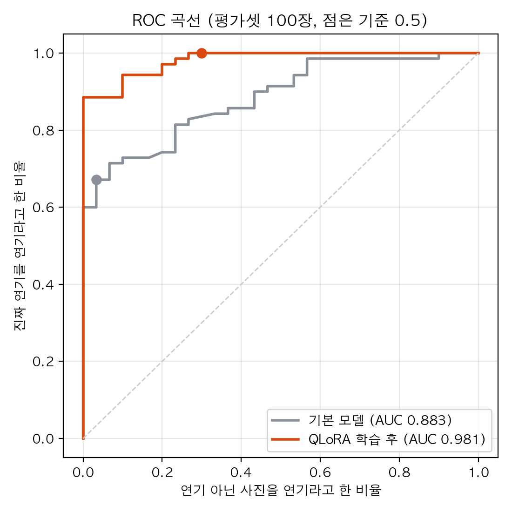

# VLM 연기 검증기 QLoRA 추가 실험

**탐지 모델이 연기로 의심한 조각을 다시 확인하는 VLM을 QLoRA로 추가 학습하고, 학습 전후를 비교한 개인 실험**

엣지아이(EdgeEye) 캡스톤디자인 팀 프로젝트를 바탕으로 한 개인 추가 실험

[🔗 팀 프로젝트 저장소](https://github.com/Yejineeeee/GIS) | [📊 사진별 점수](results/eval_probs.csv) | [📈 ROC 곡선](results/roc_curve.png)

&nbsp;&nbsp;&nbsp;

 

## 🎯 한눈에 보기

| | |
|---|---|
| **문제** | 기본 VLM 검증기는 같은 평가셋에서 진짜 연기 70장 중 23장을 놓쳤다 |
| **내가 한 일** | 학습 조각 800개 구성, QLoRA 학습, 평가셋 100장으로 학습 전후 비교 (이 실험은 단독 진행, 팀 코드는 수정하지 않음) |
| **핵심 결과** | AUC **0.883 → 0.981**, 연기 통과 **47/70 → 70/70** |
| **한계 (먼저 밝힘)** | 헛탐지 걸러냄이 29/30 → 21/30으로 줄었고, 굴뚝연기 15장 중 7장을 오인했다. 평가셋 100장, 1회 실행이라 작은 차이는 우연일 수 있다 |

 

## 📌 프로젝트 개요

| 항목 | 내용 |
|---|---|
| 기간 | [YYYY.MM ~ YYYY.MM] |
| 형태 | 개인 추가 실험 (팀 코드는 바꾸지 않았다) |
| 모델 | Qwen2.5-VL-3B-Instruct, 4bit(nf4) QLoRA, LoRA r=16, 2바퀴 |
| 학습 환경 | Google Colab T4 |
| 내 역할 | 팀 프로젝트에서는 평가셋 구성, 좌표 변환과 지리 조회, 판정 모듈을 맡았다. 이 실험의 QLoRA 학습과 평가는 혼자 진행했다. 탐지 모델과 VLM 선정은 팀원이 담당했다. |

탐지 모델이 연기로 의심한 부분을 VLM이 "연기가 있나요? 예/아니오"로 다시 확인한다.
기본 모델(추가 학습 없음)은 같은 평가셋에서 진짜 연기 70장 중 23장을 "아니오"라고 답해 놓쳤다.

이 실험은 연기와 연기처럼 보이는 것(구름, 안개, 굴뚝연기)을 구분하는 데이터로 검증기를 추가 학습해, 진짜 연기를 놓치는 일이 줄어드는지 확인하는 것을 목표로 한다.

 

## 🧪 실험 방법

1. **데이터**: AI Hub 산불 데이터(71330)에서 연기 조각 400개와 오탐 유발 조각(구름, 안개, 굴뚝연기) 400개를 만들었다 (`make_crops.py`).
2. **학습**: Qwen2.5-VL-3B-Instruct를 4bit(nf4)로 불러 LoRA(r=16)로 2바퀴 학습했다.
3. **평가**: 평가셋 100장(연기 70, 오탐 유발 30)으로 학습 전후를 같은 방식으로 비교했다. 기준 확률은 0.5이다.

평가 지역(모래고개입구, 장현동)은 학습에서 제외하고, 영상 단위로 학습용과 확인용을 나눴다.
오탐 조각은 대부분 라벨 위치로 잘랐고, 일부는 팀 탐지 모델이 연기로 잡은 위치로 잘랐다.

| 구분 | 장수 | 구성 |
|---|---|---|
| 학습 | 693 | 연기 349, 오탐 344 |
| 확인용 | 107 | |
| 평가 | 100 | 연기 70 (백색/회색 40, 흑색 30), 오탐 유발 30 (구름 15, 굴뚝연기 15) |

만든 조각 전체의 구성은 다음과 같다.

| 구분 | 개수 | 구성 |
|---|---|---|
| 연기 | 400 | 백색/회색연기 239, 흑색연기 150, 화염 장면의 연기 영역 11 |
| 오탐 유발 | 400 | 구름 184, 굴뚝연기 125, 안개/연무 91 (라벨 위치 327, 탐지 모델이 연기로 잡은 위치 73) |

 

## 📊 결과

평가셋 100장, 1회 실행 기준이다.

| 항목 | 기본 모델 | QLoRA 학습 후 |
|---|---|---|
| AUC | 0.883 | **0.981** |
| 연기 통과 | 47/70 | **70/70** |
| 헛탐지 걸러냄 | 29/30 | 21/30 |

종류별로 "예"라고 답한 개수는 다음과 같다.

| 정답 | 종류 | 장수 | 기본 모델 | 학습 후 |
|---|---|---|---|---|
| 연기 | 백색/회색연기 | 40 | 26 | 40 |
| 연기 | 흑색연기 | 30 | 21 | 30 |
| 연기 아님 | 구름 | 15 | 1 | 2 |
| 연기 아님 | 굴뚝연기 | 15 | 0 | 7 |

사진별 점수는 [results/eval_probs.csv](results/eval_probs.csv)에 있다.

### 해석과 한계

- 진짜 연기는 모두 통과시켜 놓치는 경우가 없어졌고, 구분 점수(AUC)도 올랐다.
- 기본 모델은 "아니오"를 많이 답하는 모델이라 헛탐지 걸러냄 29/30은 장점으로 보기 어렵다. 학습 후에는 균형이 바뀌어 헛탐지 걸러냄이 21/30으로 줄었다.
- 굴뚝연기 15장 중 7장을 연기로 오인했다. 학습 데이터에 굴뚝연기 조각이 125개 있었는데도 오인이 많아서, 단순히 데이터가 적어서만은 아닌 것으로 보인다. 사진 조각만으로는 굴뚝 옆인지 알기 어렵기 때문이라고 추측하며, 확인한 것은 아니다. 주변 건물 정보(GIS)로 보완하는 방향을 생각하고 있다.
- 평가셋이 100장(오탐 30장)이고 1회만 실행해서 작은 차이는 우연일 수 있다.
- 평가셋에는 안개/연무 사진이 없어 안개에 대한 성능은 확인하지 못했다.
- 기본 모델 점수는 이 실험의 질문 문구로 다시 잰 값이며, 팀 보고서의 수치와 직접 비교할 수 없다.

 

## 📂 폴더 구조

| 경로 | 내용 |
|---|---|
| `make_crops.py` | 연기 조각과 오탐 유발 조각 만들기 |
| `results/eval_probs.csv` | 평가셋 사진별 점수 (기본 모델, QLoRA 학습 후) |
| `results/roc_curve.png` | ROC 곡선 |

<!-- 학습 노트북(qlora_train_eval.ipynb)을 올리면 위 표에 행을 추가한다 -->

 

## 🔁 재현

AI Hub 71330 데이터는 직접 신청해서 받아야 하며 이 저장소에 포함하지 않는다. 팀 탐지 모델(`best.pt`)과 평가셋 목록도 포함하지 않는다.
